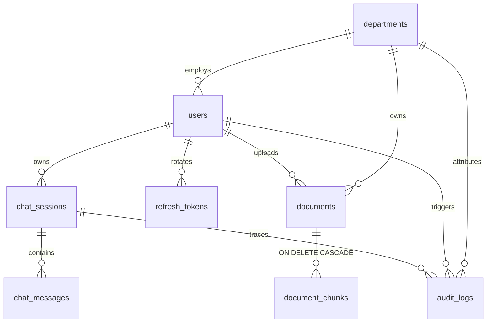

# DA-6 Design Spec — Day 2: Complete Database Schema (Flyway V1..V3), HNSW/GIN Vector Indexes & Persistence Layer

- **Jira Issue:** `DA-6` (Parent Epic: `DA-1`, Sprint 1)
- **Date:** 2026-11-15
- **Prerequisites:** `DA-5` (Docker PostgreSQL 16 `pgvector`, Spring Boot `3.4.5`, Java 21 Virtual Threads, Spring AI `1.0.3` GA)

---

## 1. Goal & Acceptance Criteria

Design and initialize all **9 database tables** (`7` relational tables + `2` `1024`-dimension `pgvector` tables) via Flyway migrations (`V1..V3`), configure `HNSW` (`m = 16, ef_construction = 64`) and `GIN` JSONB indexes, implement the layered Domain Enums, JPA Entities, Spring Data JPA Repositories, and `JdbcClient` Vector Repositories, and verify schema/index execution via Testcontainers and live PostgreSQL.

### Acceptance Criteria
1. Application startup executes all 3 Flyway migrations (`V1__init_relational_schema.sql`, `V2__init_pgvector_and_semantic_cache.sql`, `V3__seed_dev_data.sql`) cleanly with zero errors, passing both Hibernate schema validation (`ddl-auto: validate`) and Spring AI vector table validation (`pgvector.schema-validation: true`).
2. All **9 tables** (`departments`, `users`, `refresh_tokens`, `documents`, `chat_sessions`, `chat_messages`, `audit_logs`, `document_chunks`, `semantic_cache`) enforce strict domain constraints (`CHECK`, `UNIQUE`, `FOREIGN KEY`), including `ON DELETE CASCADE` from `documents` to `document_chunks` while remaining 100% compatible with Spring AI `PgVectorStore.add(...)`.
3. `V3__seed_dev_data.sql` (`classpath:db/seed`, active in default/dev/test and excluded in `prod`) seeds 3 departments (`IT`, `HR`, `SALES`) and 3 BCrypt-hashed sample accounts covering all 3 RBAC roles.
4. Automated `EXPLAIN` queries on cosine distance (`<=>`) against `document_chunks` and `semantic_cache` confirm PostgreSQL selects `Index Scan using idx_document_chunks_embedding_hnsw` and `Index Scan using idx_semantic_cache_embedding_hnsw`.

---

## 2. Architectural Decisions

### 2.1 Hybrid Persistence Boundary (JPA for Relational + `PgVectorStore`/`JdbcClient` for Vector)
- **7 Relational Tables (`V1`):** Mapped via JPA `@Entity` classes (`com.documind.domain.entity`) and Spring Data `JpaRepository` interfaces (`com.documind.repository`). All `@ManyToOne` associations use `FetchType.LAZY` (`open-in-view: false`), and JSONB payloads (`chat_messages.citations`) use Hibernate 6 native `@JdbcTypeCode(SqlTypes.JSON)`.
- **2 Vector Tables (`V2`):** Accessed via Spring AI `VectorStore` (`PgVectorStore`) and lightweight `JdbcClient` repositories (`com.documind.infrastructure.vector`) without adding `hibernate-vector` or loading `float[1024]` arrays into JPA Persistence Context memory.
- **Trigger-Synchronized `ON DELETE CASCADE` on `document_chunks`:** Spring AI `1.0.3` `PgVectorStore` executes hardcoded `INSERT INTO public.document_chunks (id, content, metadata, embedding) VALUES (?, ?, ?::jsonb, ?) ON CONFLICT (id) DO UPDATE ...`. To preserve native `PgVectorStore` compatibility *and* guarantee zero orphan vectors at the database level, `document_chunks` defines `document_id UUID NOT NULL REFERENCES documents(id) ON DELETE CASCADE` (plus `doc_version`, `chunk_index`, `page_number`) populated automatically by a `BEFORE INSERT OR UPDATE` trigger (`trg_sync_document_chunk_metadata`) reading `NEW.metadata` (`V4` hardens this to reject missing `doc_version`/`chunk_index`, validate parent `department_id`/`access_level` ownership, normalize `page_number`, and propagate `documents` RBAC changes via `trg_propagate_document_rbac_to_chunks`).
- **HNSW Filtered Search (`iterative_scan`):** `application.yml` configures Hikari `connection-init-sql: SET hnsw.iterative_scan = 'relaxed_order'` (requiring pgvector `>= 0.8.0`, pinned to digest in `docker-compose.yml` and `PostgresTestcontainersConfig`) so RBAC-filtered `PgVectorStore` searches never truncate below `topK` on small departments, while `SemanticCacheVectorRepository` uses pgvector's `MATERIALIZED` CTE re-ranking pattern.

### 2.2 Canonical Enum & RBAC Semantics
- Stored in PostgreSQL as `VARCHAR` columns guarded by explicit `CHECK` constraints (`@Enumerated(EnumType.STRING)` in JPA) for clean Flyway evolution and zero PostgreSQL custom-type cast friction:
  - `Role`: `SYSTEM_ADMIN`, `DEPARTMENT_MANAGER`, `STANDARD_EMPLOYEE`
  - `AccessLevel`: `PUBLIC`, `DEPARTMENT`, `CONFIDENTIAL` (`CONFIDENTIAL` visible to `SYSTEM_ADMIN` and owning `DEPARTMENT_MANAGER`, hidden from `STANDARD_EMPLOYEE`)
  - `DocumentStatus`: `PENDING`, `PROCESSING`, `COMPLETED`, `FAILED`
  - `MessageRole`: `USER`, `ASSISTANT`
  - `CacheTier`: `NONE`, `L1`, `L2`
  - `AuditActionType`: `CHAT_QUERY`, `DOC_UPLOAD`, `DOC_REINDEX`, `DOC_DELETE`, `AUTH_LOGIN`, `AUTH_LOGOUT`, `RATE_LIMITED`

### 2.3 Document Deduplication, Hard Delete & Zero-Downtime Re-indexing
- **Per-Department Deduplication (`DA-7`):** `UNIQUE (department_id, file_hash)` enforces atomic `409 Conflict` detection on SHA-256 hash collisions within the same department.
- **Hard Delete:** `DELETE FROM documents WHERE id = :id` triggers PostgreSQL `ON DELETE CASCADE` on `document_chunks`, immediately purging all associated vector embeddings and freeing `(department_id, file_hash)` for future re-uploads.
- **Versioned Chunk Swap (`DA-17`):** `documents.current_version` (`DEFAULT 1`) pairs with `document_chunks.doc_version` (`DEFAULT 1`) so re-indexing can embed `current_version + 1` in the background and atomically delete `< new_version` chunks upon completion.

### 2.4 RBAC-Scoped 2-Tier Cache Versioning within 9 Tables (`DA-19`)
- `departments.cache_version` (`BIGINT NOT NULL DEFAULT 1`) tracks data freshness without introducing a 10th table:
  - Updating/uploading/deleting a `DEPARTMENT` or `CONFIDENTIAL` document increments `cache_version` on the owning department row (`1` row update).
  - Updating/uploading/deleting a `PUBLIC` document increments `cache_version` across all rows in `departments` (`UPDATE departments SET cache_version = cache_version + 1`).
  - `SYSTEM_ADMIN` global scope derives its version from `SUM(cache_version)` across `departments`.
- `semantic_cache` binds `rbac_scope` (`DEPT:<dept_id>:EMPLOYEE`, `DEPT:<dept_id>:MANAGER`, `GLOBAL:ADMIN`) and `scope_version`, preventing cross-department and `CONFIDENTIAL` -> `STANDARD_EMPLOYEE` cache poisoning.

---

## 3. Complete Database Schema & Flyway Migrations



### 3.1 `V1__init_relational_schema.sql` (`classpath:db/migration`)

Creates the `set_updated_at_timestamp()` trigger function and all **7 relational tables**:

1. **`departments`**
   - `id UUID PRIMARY KEY DEFAULT gen_random_uuid()`
   - `code VARCHAR(32) NOT NULL CONSTRAINT uq_departments_code UNIQUE`
   - `name VARCHAR(120) NOT NULL`
   - `description TEXT`
   - `cache_version BIGINT NOT NULL DEFAULT 1 CONSTRAINT chk_departments_cache_version CHECK (cache_version >= 1)`
   - `created_at TIMESTAMPTZ NOT NULL DEFAULT CURRENT_TIMESTAMP`
   - `updated_at TIMESTAMPTZ NOT NULL DEFAULT CURRENT_TIMESTAMP`
   - Case-insensitive unique index: `uq_departments_code_lower (LOWER(code))`

2. **`users`**
   - `id UUID PRIMARY KEY DEFAULT gen_random_uuid()`
   - `department_id UUID NOT NULL CONSTRAINT fk_users_department REFERENCES departments(id) ON DELETE RESTRICT`
   - `email VARCHAR(255) NOT NULL CONSTRAINT uq_users_email UNIQUE`
   - `password_hash VARCHAR(255) NOT NULL`
   - `full_name VARCHAR(150) NOT NULL`
   - `role VARCHAR(32) NOT NULL CONSTRAINT chk_users_role CHECK (role IN ('SYSTEM_ADMIN', 'DEPARTMENT_MANAGER', 'STANDARD_EMPLOYEE'))`
   - `is_active BOOLEAN NOT NULL DEFAULT TRUE`
   - `created_at TIMESTAMPTZ NOT NULL DEFAULT CURRENT_TIMESTAMP`
   - `updated_at TIMESTAMPTZ NOT NULL DEFAULT CURRENT_TIMESTAMP`
   - Indexes: `uq_users_email_lower (LOWER(email))`, `idx_users_department_id (department_id)`, `idx_users_role (role)`

3. **`refresh_tokens`**
   - `id UUID PRIMARY KEY DEFAULT gen_random_uuid()`
   - `user_id UUID NOT NULL CONSTRAINT fk_refresh_tokens_user REFERENCES users(id) ON DELETE CASCADE`
   - `token_hash VARCHAR(64) NOT NULL CONSTRAINT uq_refresh_tokens_hash UNIQUE`
   - `expires_at TIMESTAMPTZ NOT NULL`
   - `revoked_at TIMESTAMPTZ`
   - `replaced_by_hash VARCHAR(64)`
   - `user_agent VARCHAR(512)`
   - `ip_address VARCHAR(45)`
   - `created_at TIMESTAMPTZ NOT NULL DEFAULT CURRENT_TIMESTAMP`
   - Indexes: `idx_refresh_tokens_user_revoked (user_id, revoked_at)`, `idx_refresh_tokens_expires_at (expires_at)`

4. **`documents`**
   - `id UUID PRIMARY KEY DEFAULT gen_random_uuid()`
   - `department_id UUID NOT NULL CONSTRAINT fk_documents_department REFERENCES departments(id) ON DELETE RESTRICT`
   - `uploaded_by UUID CONSTRAINT fk_documents_uploaded_by REFERENCES users(id) ON DELETE SET NULL`
   - `original_name VARCHAR(255) NOT NULL`
   - `storage_key VARCHAR(512) NOT NULL CONSTRAINT uq_documents_storage_key UNIQUE`
   - `file_extension VARCHAR(16) NOT NULL CONSTRAINT chk_documents_extension CHECK (file_extension IN ('pdf', 'docx', 'txt', 'md'))`
   - `mime_type VARCHAR(128) NOT NULL`
   - `file_size_bytes BIGINT NOT NULL CONSTRAINT chk_documents_size CHECK (file_size_bytes > 0 AND file_size_bytes <= 52428800)`
   - `file_hash VARCHAR(64) NOT NULL`
   - `access_level VARCHAR(32) NOT NULL CONSTRAINT chk_documents_access_level CHECK (access_level IN ('PUBLIC', 'DEPARTMENT', 'CONFIDENTIAL'))`
   - `status VARCHAR(32) NOT NULL CONSTRAINT chk_documents_status CHECK (status IN ('PENDING', 'PROCESSING', 'COMPLETED', 'FAILED'))`
   - `current_version INT NOT NULL DEFAULT 1 CONSTRAINT chk_documents_version CHECK (current_version >= 1)`
   - `chunk_count INT NOT NULL DEFAULT 0 CONSTRAINT chk_documents_chunk_count CHECK (chunk_count >= 0)`
   - `error_message TEXT`
   - `created_at TIMESTAMPTZ NOT NULL DEFAULT CURRENT_TIMESTAMP`
   - `updated_at TIMESTAMPTZ NOT NULL DEFAULT CURRENT_TIMESTAMP`
   - Constraints & Indexes: `CONSTRAINT uq_documents_department_hash UNIQUE (department_id, file_hash)`, `idx_documents_dept_access_status (department_id, access_level, status)`, `idx_documents_status_created (status, created_at DESC)`

5. **`chat_sessions`**
   - `id UUID PRIMARY KEY DEFAULT gen_random_uuid()`
   - `user_id UUID NOT NULL CONSTRAINT fk_chat_sessions_user REFERENCES users(id) ON DELETE CASCADE`
   - `title VARCHAR(255) NOT NULL`
   - `created_at TIMESTAMPTZ NOT NULL DEFAULT CURRENT_TIMESTAMP`
   - `updated_at TIMESTAMPTZ NOT NULL DEFAULT CURRENT_TIMESTAMP`
   - Index: `idx_chat_sessions_user_updated (user_id, updated_at DESC)`

6. **`chat_messages`**
   - `id UUID PRIMARY KEY DEFAULT gen_random_uuid()`
   - `session_id UUID NOT NULL CONSTRAINT fk_chat_messages_session REFERENCES chat_sessions(id) ON DELETE CASCADE`
   - `role VARCHAR(20) NOT NULL CONSTRAINT chk_chat_messages_role CHECK (role IN ('USER', 'ASSISTANT'))`
   - `content TEXT NOT NULL`
   - `rewritten_query TEXT`
   - `citations JSONB NOT NULL DEFAULT '[]'::jsonb`
   - `abstained BOOLEAN NOT NULL DEFAULT FALSE`
   - `cache_tier VARCHAR(16) NOT NULL DEFAULT 'NONE' CONSTRAINT chk_chat_messages_cache_tier CHECK (cache_tier IN ('NONE', 'L1', 'L2'))`
   - `prompt_tokens INT NOT NULL DEFAULT 0 CONSTRAINT chk_chat_messages_prompt_tokens CHECK (prompt_tokens >= 0)`
   - `completion_tokens INT NOT NULL DEFAULT 0 CONSTRAINT chk_chat_messages_completion_tokens CHECK (completion_tokens >= 0)`
   - `latency_ms BIGINT CONSTRAINT chk_chat_messages_latency CHECK (latency_ms IS NULL OR latency_ms >= 0)`
   - `model_provider VARCHAR(64)`
   - `created_at TIMESTAMPTZ NOT NULL DEFAULT CURRENT_TIMESTAMP`
   - Index: `idx_chat_messages_session_created (session_id, created_at ASC)`

7. **`audit_logs`**
   - `id UUID PRIMARY KEY DEFAULT gen_random_uuid()`
   - `user_id UUID CONSTRAINT fk_audit_logs_user REFERENCES users(id) ON DELETE SET NULL`
   - `department_id UUID CONSTRAINT fk_audit_logs_department REFERENCES departments(id) ON DELETE SET NULL`
   - `session_id UUID CONSTRAINT fk_audit_logs_session REFERENCES chat_sessions(id) ON DELETE SET NULL`
   - `action_type VARCHAR(40) NOT NULL CONSTRAINT chk_audit_logs_action_type CHECK (action_type IN ('CHAT_QUERY', 'DOC_UPLOAD', 'DOC_REINDEX', 'DOC_DELETE', 'AUTH_LOGIN', 'AUTH_LOGOUT', 'RATE_LIMITED'))`
   - `query_text TEXT`
   - `abstained BOOLEAN NOT NULL DEFAULT FALSE`
   - `cache_hit BOOLEAN NOT NULL DEFAULT FALSE`
   - `cache_tier VARCHAR(16) NOT NULL DEFAULT 'NONE' CONSTRAINT chk_audit_logs_cache_tier CHECK (cache_tier IN ('NONE', 'L1', 'L2'))`
   - `prompt_tokens INT NOT NULL DEFAULT 0 CONSTRAINT chk_audit_logs_prompt_tokens CHECK (prompt_tokens >= 0)`
   - `completion_tokens INT NOT NULL DEFAULT 0 CONSTRAINT chk_audit_logs_completion_tokens CHECK (completion_tokens >= 0)`
   - `latency_ms BIGINT NOT NULL DEFAULT 0 CONSTRAINT chk_audit_logs_latency CHECK (latency_ms >= 0)`
   - `provider VARCHAR(64)`
   - `status_code INT NOT NULL DEFAULT 200`
   - `ip_address VARCHAR(45)`
   - `created_at TIMESTAMPTZ NOT NULL DEFAULT CURRENT_TIMESTAMP`
   - Constraint: `chk_audit_logs_cache_consistency CHECK ((cache_hit = FALSE AND cache_tier = 'NONE') OR (cache_hit = TRUE AND cache_tier IN ('L1', 'L2')))`
   - Indexes: `idx_audit_logs_created_at (created_at DESC)`, `idx_audit_logs_dept_created (department_id, created_at DESC)`, `idx_audit_logs_action_created (action_type, created_at DESC)`

### 3.2 `V2__init_pgvector_and_semantic_cache.sql` (`classpath:db/migration`)

Enables `CREATE EXTENSION IF NOT EXISTS vector;` and creates the **2 vector tables**, trigger, and HNSW/GIN indexes:

8. **`document_chunks`**
   - `id UUID PRIMARY KEY DEFAULT gen_random_uuid()`
   - `document_id UUID NOT NULL CONSTRAINT fk_document_chunks_document REFERENCES documents(id) ON DELETE CASCADE`
   - `doc_version INT NOT NULL DEFAULT 1 CONSTRAINT chk_document_chunks_version CHECK (doc_version >= 1)`
   - `chunk_index INT NOT NULL DEFAULT 0 CONSTRAINT chk_document_chunks_index CHECK (chunk_index >= 0)`
   - `page_number INT CONSTRAINT chk_document_chunks_page CHECK (page_number IS NULL OR page_number >= 1)`
   - `content TEXT NOT NULL`
   - `metadata JSONB NOT NULL DEFAULT '{}'::jsonb` (guarded by `chk_document_chunks_rbac_metadata` requiring non-blank `document_id`, `department_id`, `file_name`, and `access_level IN ('PUBLIC', 'DEPARTMENT', 'CONFIDENTIAL')`)
   - `embedding vector(1024) NOT NULL`
   - `created_at TIMESTAMPTZ NOT NULL DEFAULT CURRENT_TIMESTAMP`
   - **Trigger `trg_sync_document_chunk_metadata` (`BEFORE INSERT OR UPDATE`):**
     Synchronizes `metadata->>'document_id'`, `metadata->>'doc_version'` (defaulting to `1`), `metadata->>'chunk_index'` (defaulting to `0`), and `metadata->>'page_number'` (nullable `INT`, cleared to `NULL` if omitted on `ON CONFLICT DO UPDATE`).
   - **Indexes:**
     - `idx_document_chunks_embedding_hnsw`: `USING hnsw (embedding vector_cosine_ops) WITH (m = 16, ef_construction = 64)`
     - `idx_document_chunks_metadata_gin`: `USING gin (metadata)`
     - `idx_document_chunks_doc_version`: `(document_id, doc_version)`

9. **`semantic_cache`**
   - `id UUID PRIMARY KEY DEFAULT gen_random_uuid()`
   - `rbac_scope VARCHAR(128) NOT NULL`
   - `scope_version BIGINT NOT NULL CONSTRAINT chk_semantic_cache_scope_version CHECK (scope_version >= 1)`
   - `query_hash VARCHAR(64) NOT NULL`
   - `query_text TEXT NOT NULL`
   - `query_embedding vector(1024) NOT NULL`
   - `response_content TEXT NOT NULL`
   - `citations JSONB NOT NULL DEFAULT '[]'::jsonb`
   - `model_provider VARCHAR(64)`
   - `hit_count INT NOT NULL DEFAULT 0 CONSTRAINT chk_semantic_cache_hit_count CHECK (hit_count >= 0)`
   - `created_at TIMESTAMPTZ NOT NULL DEFAULT CURRENT_TIMESTAMP`
   - `expires_at TIMESTAMPTZ`
   - **Constraints & Indexes:**
     - `uq_semantic_cache_scope_hash`: `UNIQUE (rbac_scope, scope_version, query_hash)` (supports idempotent `ON CONFLICT DO UPDATE` writes)
     - `idx_semantic_cache_embedding_hnsw`: `USING hnsw (query_embedding vector_cosine_ops) WITH (m = 16, ef_construction = 64)` (queried with `SET LOCAL hnsw.iterative_scan = 'relaxed_order'`)
     - `idx_semantic_cache_scope_lookup`: `(rbac_scope, scope_version)`

### 3.3 `V3__seed_dev_data.sql` (`classpath:db/seed`)

Idempotent (`ON CONFLICT DO NOTHING`) seed script with deterministic UUIDs and a precomputed BCrypt cost-10 hash (`$2a$10$q6.0PtDMsJDIKJWkOmdXFefwSPRiXyK4dWz5JIOMMZUEt/e35s8yi` for dev password `DocuMind@2026!`):

| Entity | Fixed UUID | Code / Email | Role / Details |
| :--- | :--- | :--- | :--- |
| Department `IT` | `11111111-1111-1111-1111-111111111111` | `IT` | Công nghệ Thông tin (`cache_version = 1`) |
| Department `HR` | `22222222-2222-2222-2222-222222222222` | `HR` | Hành chính Nhân sự (`cache_version = 1`) |
| Department `SALES` | `33333333-3333-3333-3333-333333333333` | `SALES` | Kinh doanh & Phát triển Thị trường (`cache_version = 1`) |
| User (Admin) | `aaaaaaaa-aaaa-aaaa-aaaa-aaaaaaaaaaaa` | `admin@documind.ai` | `SYSTEM_ADMIN` in `IT` |
| User (Manager) | `bbbbbbbb-bbbb-bbbb-bbbb-bbbbbbbbbbbb` | `manager.hr@documind.ai` | `DEPARTMENT_MANAGER` in `HR` |
| User (Employee) | `cccccccc-cccc-cccc-cccc-cccccccccccc` | `employee.sales@documind.ai` | `STANDARD_EMPLOYEE` in `SALES` |

### 3.4 `V4__harden_schema_and_rbac_invariants.sql` (`classpath:db/migration`)

Additive post-merge migration (leaving `V1` and `V2` byte-for-byte immutable) enforcing:
- Case-insensitive unique indexes `uq_departments_code_lower` and `uq_users_email_lower`.
- `uq_documents_storage_key`, `chk_audit_logs_cache_consistency` (`NOT VALID` -> `VALIDATE CONSTRAINT`), and `uq_semantic_cache_scope_hash`.
- Hardened `sync_document_chunk_metadata()` requiring `document_id`, `department_id`, `file_name`, `access_level`, `doc_version`, and `chunk_index`, normalizing `page_number` to JSON `null` when omitted, validating parent `documents.department_id` and `documents.access_level` ownership, plus `chk_document_chunks_rbac_metadata` and `uq_document_chunks_doc_version_index`.
- `trg_propagate_document_rbac_to_chunks` (`AFTER UPDATE OF department_id, access_level ON documents`) propagating RBAC metadata updates to existing `document_chunks`.

---

## 4. Backend Package & Class Design (`backend/`)

```text
backend/src/main/
├── java/com/documind/
│   ├── domain/
│   │   ├── enums/
│   │   │   ├── Role.java
│   │   │   ├── AccessLevel.java
│   │   │   ├── DocumentStatus.java
│   │   │   ├── MessageRole.java
│   │   │   ├── CacheTier.java
│   │   │   └── AuditActionType.java
│   │   ├── model/
│   │   │   └── CitationPayload.java          # Java record stored in JSONB citations
│   │   └── entity/
│   │       ├── DepartmentEntity.java
│   │       ├── UserEntity.java
│   │       ├── RefreshTokenEntity.java
│   │       ├── DocumentEntity.java
│   │       ├── ChatSessionEntity.java
│   │       ├── ChatMessageEntity.java
│   │       └── AuditLogEntity.java
│   ├── repository/
│   │   ├── DepartmentRepository.java
│   │   ├── UserRepository.java
│   │   ├── RefreshTokenRepository.java
│   │   ├── DocumentRepository.java
│   │   ├── ChatSessionRepository.java
│   │   ├── ChatMessageRepository.java
│   │   └── AuditLogRepository.java
│   └── infrastructure/
│       └── vector/
│           ├── SemanticCacheEntry.java       # Java record for L2 cache row
│           ├── DocumentChunkVectorRepository.java
│           └── SemanticCacheVectorRepository.java
└── resources/
    ├── application.yml                       # flyway locations: db/migration,db/seed; ddl-auto: validate; schema-validation: true
    ├── application-prod.yml                  # flyway locations: db/migration (no dev seeds)
    ├── db/migration/
    │   ├── V1__init_relational_schema.sql
    │   └── V2__init_pgvector_and_semantic_cache.sql
    └── db/seed/
        └── V3__seed_dev_data.sql
```

### Key Repository Contracts
- `DepartmentRepository`: `findByCodeIgnoreCase(String code)`, `@Modifying incrementCacheVersion(UUID id)`, `@Modifying incrementAllCacheVersions()`, `sumCacheVersions()`.
- `UserRepository`: `findByEmailIgnoreCase(String email)` (`@EntityGraph(attributePaths = "department")` for JWT auth lookup), `existsByEmailIgnoreCase(String email)`.
- `RefreshTokenRepository`: `findByTokenHash(String tokenHash)`, `@Modifying revokeAllActiveByUserId(UUID userId, OffsetDateTime now)`.
- `DocumentRepository`: `existsByDepartmentIdAndFileHash(UUID departmentId, String fileHash)`, `findByDepartmentIdOrderByCreatedAtDesc(UUID departmentId)`.
- `ChatSessionRepository`: `findByUserIdOrderByUpdatedAtDesc(UUID userId)`, `findByIdAndUserId(UUID id, UUID userId)`.
- `ChatMessageRepository`: `findBySessionIdOrderByCreatedAtAsc(UUID sessionId)`, `findTop6BySessionIdOrderByCreatedAtDesc(UUID sessionId)`.
- `AuditLogRepository`: paginated queries by department / action type for `DA-20` analytics.
- `DocumentChunkVectorRepository` (`JdbcClient`): `deleteByDocumentIdAndVersionLessThan(UUID documentId, int keepVersion)`, `countByDocumentId(UUID documentId)`, `explainCosineSearch(float[] queryVector, int limit)`.
- `SemanticCacheVectorRepository` (`JdbcClient`): `insert(...)`, `findTopMatch(String rbacScope, long scopeVersion, float[] queryVector, double minSimilarity)`, `explainCosineSearch(String rbacScope, long scopeVersion, float[] queryVector, int limit)`.

---

## 5. Testing & Verification Strategy

1. **Testcontainers Dependencies (`pom.xml`):**
   - Add `org.springframework.boot:spring-boot-testcontainers`, `org.testcontainers:junit-jupiter`, and `org.testcontainers:postgresql` (`<scope>test</scope>`).
2. **Automated Integration Suite (`SchemaAndHnswIntegrationTest`):**
   - Spins up singleton `PostgreSQLContainer<>("pgvector/pgvector:pg16")` via `@ServiceConnection` with a deterministic 1024-dim `@TestConfiguration` `EmbeddingModel` (so `.\mvnw.cmd test` executes cleanly without requiring external API keys or local Ollama).
   - Verifies:
     - `flyway_schema_history` records `V1`, `V2`, `V3` with `success = true`.
     - Hibernate `ddl-auto: validate` and Spring AI `PgVectorSchemaValidator` pass on startup.
     - Seeded departments (`IT`, `HR`, `SALES`) and 3 users exist with valid 60-char `$2a$10$` BCrypt hashes.
     - `UNIQUE (department_id, file_hash)` rejects duplicate hashes within the same department while allowing the same hash in a different department.
     - `VectorStore.add(List<Document>)` inserts 1024-dim chunks into `document_chunks`, trigger auto-populates `document_id`, `doc_version`, `chunk_index`, and `page_number`, and `documentRepository.deleteById(docId)` cascades deletion of all chunks (`count == 0`).
     - Within a test transaction (`SET LOCAL enable_seqscan = off` so PostgreSQL's cost planner does not prefer heap scan on small test row counts), `EXPLAIN SELECT id FROM document_chunks ORDER BY embedding <=> ?::vector LIMIT 5` and `EXPLAIN SELECT id FROM semantic_cache WHERE rbac_scope = ? AND scope_version = ? ORDER BY query_embedding <=> ?::vector LIMIT 1` both contain `Index Scan using idx_document_chunks_embedding_hnsw` and `Index Scan using idx_semantic_cache_embedding_hnsw`.
3. **Production Seed Exclusion Test (`ProdFlywayLocationsTest`):**
   - Verifies that under `@ActiveProfiles("prod")` against an isolated schema/container, only `V1` and `V2` run (`users` count == `0`).
4. **Live Day-2 Smoke Check (`Day1InfrastructureAndAiSmokeTest` / Live `localhost:5432`):**
   - Verifies `V1..V3` apply cleanly on the running `documind-postgres` container (`localhost:5432`) and `/actuator/health` remains `UP`.
